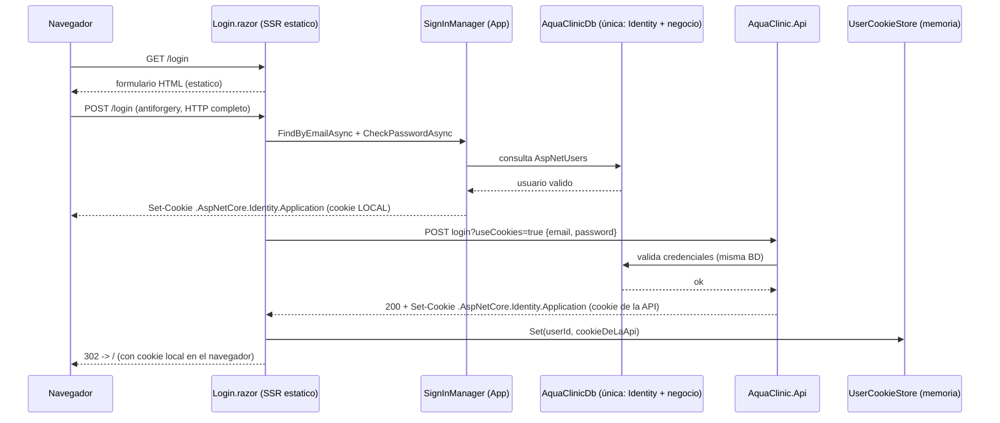
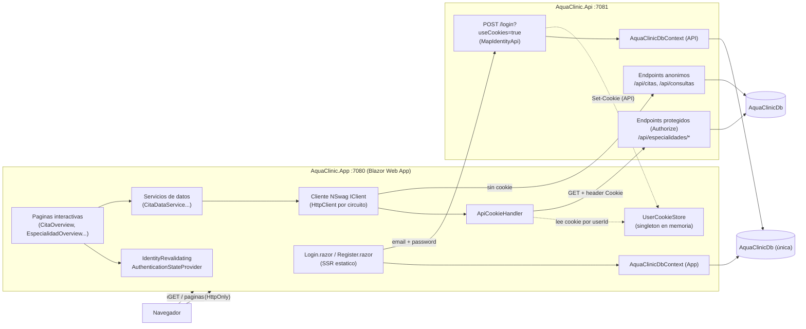
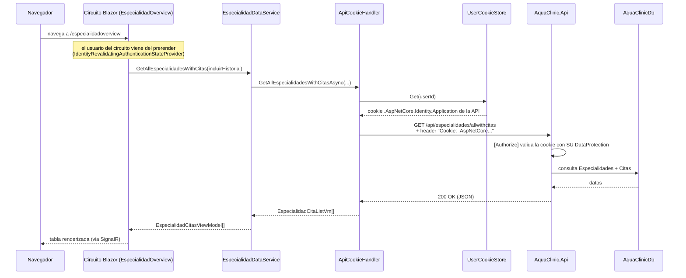
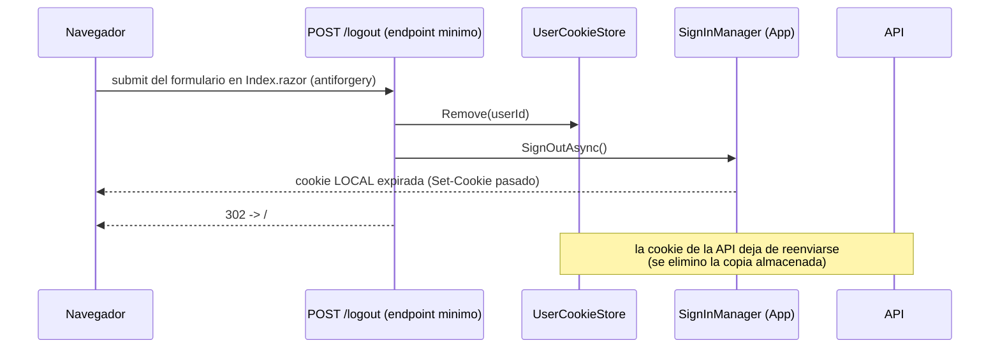

# Mapa de comunicación — Login en AquaClinic

## Actores y componentes

| Componente | Ubicación | Responsabilidad |
|---|---|---|
| Navegador | Cliente | Envía/recibe cookies, renderiza |
| `Login.razor` / `Register.razor` | AquaClinic.App | Páginas con **SSR estático** (form POST real) |
| `UserManager` / `SignInManager` | AquaClinic.App (Identidad local) | Validar credenciales y emitir cookie LOCAL |
| `AquaClinicDbContext` | App **y** API | Ambos apuntan a la misma BD única `AquaClinicDb` (Identity + negocio) |
| Cliente `"Authentication"` | AquaClinic.App | HttpClient hacia la API para "acuñar" la cookie de la API |
| `UserCookieStore` | AquaClinic.App (singleton en memoria) | Guarda `userId → cookie de la API` |
| `ApiCookieHandler` | AquaClinic.App (por circuito) | Adjunta esa cookie en las llamadas salientes a la API |
| `IdentityRevalidatingAuthenticationStateProvider` | AquaClinic.App | Estado de autenticación en circuitos interactivos (revalida cada 30 min) |
| `MapIdentityApi<ApplicationUser>()` | AquaClinic.Api | `POST /login?useCookies=true`, `/register`, `/manage/info` |
| Endpoints `[Authorize]` | AquaClinic.Api | `/api/especialidades/all` y `/api/especialidades/allwithcitas` |
| SQL LocalDB | Servidor | `AquaClinicDb` (única: usuarios AspNet* + citas/especialidades/servicios) |

## Las dos cookies

| Cookie | La emite | Vive en | Sirve para |
|---|---|---|---|
| `.AspNetCore.Identity.Application` (App) | `SignInManager` de la App | **Navegador** (HttpOnly) | Autenticar las páginas de la App |
| `.AspNetCore.Identity.Application` (API) | `MapIdentityApi` de la API | **Memoria del servidor App** (`UserCookieStore`) | Reenviarla a los endpoints protegidos de la API |

> La App y la API comparten la misma BD única (`AquaClinicDb`), por eso las mismas credenciales funcionan en los dos lados **sin necesidad de compartir claves de Data Protection**.

## 1. Secuencia de login

## 2. Mapa de componentes

## 3. Petición a un endpoint protegido desde un circuito interactivo

## 4. Logout

## 5. Registro

Idéntico al login, con un paso previo:

1. `UserManager.CreateAsync(user, password)` → crea el usuario en `AquaClinicDb` (tabla AspNetUsers)
2. `SignInManager.SignInAsync(...)` → cookie LOCAL en el navegador
3. `GuardarCookieDeLaApiAsync(...)` → acuña y guarda la cookie de la API
4. Redirect a `/`

## Decisiones de diseño y por qué

| Decisión | Motivo |
|---|---|
| Login/Registro con **SSR estático** (form POST) | Una cookie solo puede escribirse en una respuesta HTTP real; los circuitos interactivos **no pueden** establecer cookies en el navegador |
| Cookie de la API guardada **en el servidor** | Los circuitos Blazor Server no tienen acceso a las cookies del navegador; el App necesita la cookie de la API en el servidor para reenviarla |
| `UserCookieStore` singleton **en memoria** | Simple y suficiente para un único servidor. Trade-off: si se reinicia la App, el usuario debe volver a iniciar sesión (los endpoints anónimos siguen funcionando) |
| Misma BD de identidad en App y API | Evita compartir claves de DataProtection entre aplicaciones; cada lado valida sus propias cookies |
| `ApiCookieHandler` resuelto **por circuito** | Puede consultar el `AuthenticationStateProvider` del circuito actual para saber qué usuario hace la petición |
| Revalidación cada 30 min | `IdentityRevalidatingAuthenticationStateProvider` compara la marca de seguridad del usuario contra la BD (bloqueo, cambio de contraseña, etc.) |
